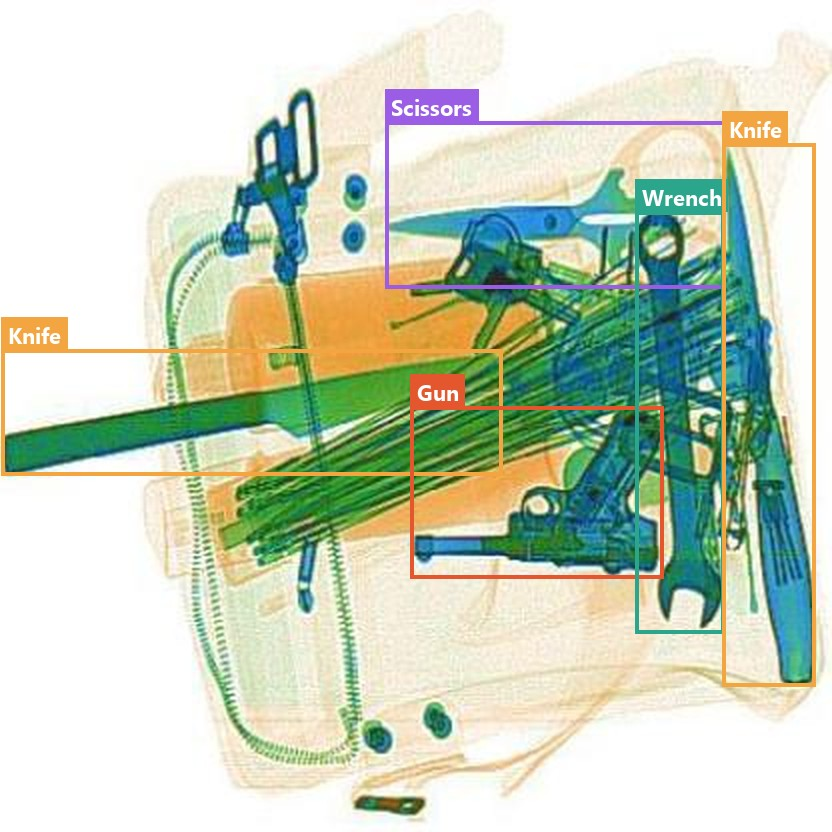
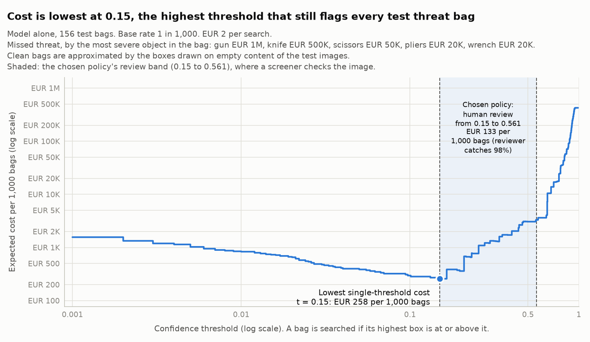

# Assignment 2 Report

- **Name**: Juan Felipe Ortiz Lejarde
- **Student ID**: 20417
- **Email**: jortiz.ieu2022@student.ie.edu
- **Group**: BBADBA 5A

## Business problem, and the cost of being wrong

The model helps airport screeners decide, from each bag's X-ray, whether it
passes or is searched by hand.

- **Who acts on it**: the screener, guided by the model's score.
- **Positive class**: a bag with a gun, knife, scissors, pliers or wrench, in
  falling order of severity. A clean bag is the negative.
- **False positive**: a clean bag is searched for nothing, costing minutes.
- **False negative**: a threat reaches the aircraft. A gun or a knife can cost
  lives.

A false alarm costs a couple of euros of time, whereas a missed gun or knife costs at least half a million euros and possibly lives.  
Every later choice in this report follows from it: I care most about recall on the dangerous classes, I would
rather send a bag to a person than let it pass, and I expect the threshold to be low.

## Dataset

- **Source**: Roboflow workspace `vladutc`, project `x-ray-baggage`, version 3
  (CC BY 4.0): https://universe.roboflow.com/vladutc/x-ray-baggage/dataset/3
- **Size**: 3,771 images. Train 3,303, valid 312, test 156.

Each X-ray has every threat boxed and named, so the model does the screener's
job: find the object and name it.

*Sample test image with its ground-truth boxes.*

| Class | Gun | Knife | Pliers | Scissors | Wrench |
|---|---:|---:|---:|---:|---:|
| Instances | 1,751 | 1,594 | 1,542 | 1,369 | 1,518 |
| Median box area (test) | 3.3% | 8.2% | 2.8% | 1.9% | 5.4% |

- **The classes are balanced**, so no class dominates training.
- **There are no clean bags**, while almost every real bag is clean, so the
  false-alarm rate cannot be measured. The only signal left is boxes drawn on the background
  of bags that do contain something. This is the biggest limitation.
- **Scissors are the hardest objects to see.** They are the smallest class, and 15.4% of all scissor boxes cover less
  than 1% of the image. I expect them to be missed more often than the rest.
- **The test split is small** (156 images, 54 to 88 objects per class), so one
  missed object moves a class's recall by 1 to 2 points.
- **What I cannot conclude**: how the model behaves on real traffic,
  on other scanners, or on clean bags.

## Finetuning and baselines

**Settings**: `yolo11s` finetuned from COCO, `imgsz=512`, `epochs=70`, `batch=16`, `patience=20`, `seed=0`; Kaggle T4 GPU 
A first `yolo11n` run at 416 px reached 0.903 mAP50.

Test split:

| Model | mAP50 | mAP50-95 |
|---|---:|---:|
| Finetuned model | 0.951 | 0.774 |
| COCO `yolo11n` zero-shot | 0.012 | 0.010 |
| Predict nothing | 0.000 | 0.000 |

COCO has no gun, pliers or wrench class, and zero-shot it found 2 of 54 scissors and no knives. The finetuned model beats both
baselines on every class. Predicting nothing is the "Do nothing" cost row.

## Per-class evaluation and failure modes

Test split, at confidence 0.25 (confusion matrix in `artifacts/results_table.md`).

| Class | AP50 | Recall | Not detected | False alarms |
|---|---:|---:|---:|---:|
| Gun | 0.977 | 0.975 | 1 | 7 |
| Knife | 0.913 | 0.875 | 8 | 17 |
| Pliers | 0.957 | 0.940 | 3 | 6 |
| Scissors | 0.976 | 0.963 | 2 | 6 |
| Wrench | 0.934 | 0.926 | 4 | 14 |

- **Gun has the best AP50 (0.977)**, and it matters most.
- **Knife is missed most** (recall 0.875).
- **Knife raises the most false alarms (17).** Long, thin knives are hard to
  box well.
- **Scissors did better than expected** (recall 0.963).
- **Mix-ups are rare**: 2 knives were called wrenches and 1 a gun.

Recall here is per object at 0.25, while the policy below works per bag.

## Cost matrix and operating point

- **Missed threat**, by the most severe object in the bag, set by the harm it
  can do on board: gun €1,000,000, knife €500,000 (half a gun), and scissors,
  pliers and wrench €50,000 each (a tenth of a knife: small tools, harder to use as a weapon).
- **Manual search**: €2. Two minutes of officer time is €0.67, plus the
  passenger's wait and the slower lane.
- **Screener check**: €0.25: 30 seconds at a loaded €20 per hour, times 1.5
  because screeners view images only 20 of every 30 minutes.

**Base rate and threat mix.** I assume 1 bag in 1,000 (0.1%) holds one of the
five objects. Scissors, knives and tools are far more common than guns in hand
luggage, so of those I assume 1% hold a gun, 20% a knife, 45% scissors, 17%
pliers and 17% a wrench; test bags are weighted to match.

**What the costs imply.** With this mix a missed threat costs €149,500 on
average, the price of about 75,000 searches. Lowering the threshold pays as long
as each extra threat caught costs fewer than 75,000
extra searches, and with a 0.1% base rate that points to a low threshold. 

- **How the sweep scores a bag**: the decision is whether to open the bag, so a
  threat bag takes its highest box score and is missed only if
  no box reaches the threshold. Each image's highest-scoring box on empty
  background stands in for a clean bag (empty means an IoU of 0.1 or
  less with every labelled box).
- **Best single threshold**: 0.04. On test it flags 155 of 156 threat bags and 16 of 156 clean stand-ins, so
  about 10% of all bags would go to a manual search. 

*Cost per 1,000 bags against the lower threshold, validation and test.*

## What the screener is for

The screener clears false alarms for €0.25 instead of a €2 search. I assume
they catch 99% of threats, since they see the model's boxes, and never send a
clean bag to search. A reviewed threat is still missed 1% of the time, so above
0.44 a search is cheaper. On test every gun and knife bag scores above 0.44.

A bag below 0.04 passes, from 0.04 to 0.44 a screener checks it, and from 0.44
it is searched. Chosen on validation (€338 per 1,000 bags), this pair costs €418
on test. The optimum is flat: pairs within 5% span 0.02 to 0.04 and 0.15 to
0.58. My first idea, an upper threshold of 0.7, costs €452.

A few small, cluttered threat bags set the low threshold: the model boxes them
correctly but with very low confidence (test: pliers 0.031, scissors 0.043). At
0.04 that pliers bag passes unchecked, as does a validation scissors bag at
0.007. 0.04 is cheapest on validation. On test, that pliers bag costs
€50,000; 0.03 would cost about €83. Thresholds come from validation, so test
pays for that one bag.

**Staffing.** At an assumed 90,700 departing bags a day at Madrid-Barajas, the
policy sends 7.7% to a screener (10.9 eight-hour shifts) and 2.7% to a search
(10.1 shifts). A screener views every image today (142 shifts), so staff
suffices.

| Option | Cost per 1,000 bags | Staff shifts a day (screener + search) |
|---|---:|---:|
| Do nothing | €149,500 | 0 |
| Manual search of every bag | €2,000 | 378 |
| A screener checks every image | €1,747 | 142 |
| Model alone (search from 0.04) | €547 | 39 |
| **Model + screener (my policy)** | **€418** | **21** |

## When the answer changes

- **Screener catch rate**: below 91.7% (validation) or 74.9% (test) the model
  alone wins. A perfect screener widens the band to 0.90 (€379).
- **Lower threshold**: moves to 0.19 if miss costs fall to 0.085 times or
  threats are rarer than about 1 in 11,800.
- **Search at officer time only (€0.67)**: upper threshold 0.19 (€401).

## Limitations & next steps

- **No clean bags, in training or in testing.** Without a negative class the
  false-alarm rate is only estimated, so the model cannot be fully trusted yet.
  Next step: add clean bags to both.
- **A small test set.** One miss in 156 threat bags says little about the miss
  rate. Next step: a bigger test set.
- **The screener's catch rate.** Next step: measure it with real
  screeners on these images.

## Generative AI use disclosure

I used generative AI during this assignment: for research on the cost figures
and the base rate; for parts of the code, such as setting up the environment,
downloading the dataset and computing the dataset tables; and to turn my own
notes into the prose of this report and format it. The decisions are mine: the
framing of the problem, the choice of dataset, the cost of each error, the
thresholds, how much goes to a person, and the conclusions.

